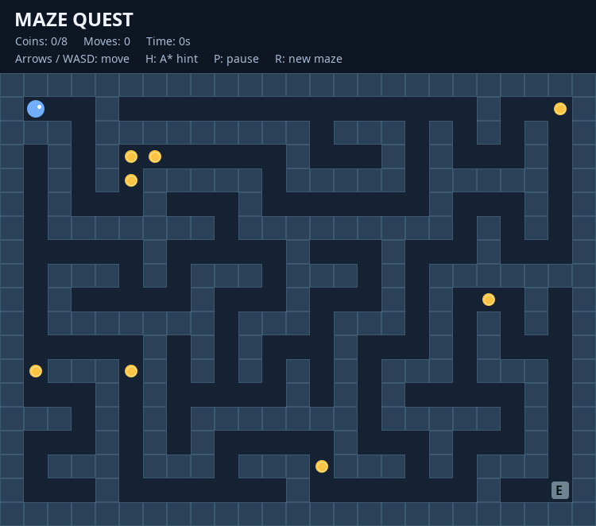

# 🎮 Maze Quest — Java 2D Maze Game

  

**Maze Quest** is a desktop maze adventure written in Java. Explore randomly generated labyrinths, collect all **8 coins**, and reach the exit. Press **H** to visualize a shortest route to a nearby coin using **A***.



## ✨ Features

- Procedurally generated, fully connected mazes (randomized DFS / recursive backtracker).
- Keyboard movement, wall collisions and collectible coins.
- Exit unlocked after all 8 coins are collected.
- A* shortest-path hint to the **closest reachable coin by path length** (or exit after collecting all coins).
- Timer, movement counter, pause, and restart.
- Swing UI; **no third-party runtime dependencies**.

## 🚀 Quick start (Ubuntu / Windows / macOS)

Requires **JDK 17 or newer** (Java 21 also works). Verify with `java -version` and `javac -version`.

**Linux/macOS, without Maven:**

```bash
bash scripts/build.sh
bash scripts/run.sh
```

**Or using Maven (if installed):**

```bash
mvn package
java -jar target/maze-quest-1.0.0.jar
```

**Windows:** install a JDK and run `mvn package` then `java -jar target/maze-quest-1.0.0.jar` in PowerShell (Maven required), or compile the sources with your Java IDE.

**Run logic tests (Linux/macOS, no external dependencies):**

```bash
bash scripts/test.sh
```

## 🎮 Controls

| Key | Action |
|---|---|
| Arrow keys or WASD | Move one tile |
| H | Toggle A* path hint |
| P | Pause / resume |
| R | New randomly generated maze |

**Victory condition:** collect every coin, then move to the tile marked **E**. The exit is visually gray until all coins are collected, then turns green.

## 🧱 Repository layout

```text
maze-quest-github/
├── README.md                # Project overview and setup
├── LICENSE                  # MIT license
├── pom.xml                  # Maven build descriptor
├── src/
│   ├── main/java/com/mazequest/
│   │   ├── app/             # Swing application entry point
│   │   ├── model/           # Game state, maze, coordinates
│   │   ├── algorithm/       # DFS maze generator and A* pathfinder
│   │   └── ui/              # Rendering and keyboard input
│   └── test/java/com/mazequest/ # Dependency-free logic tests
├── docs/
│   ├── GAME_CONCEPT.md      # Game design and intended audience
│   ├── ARCHITECTURE.md      # Components, diagrams, design decisions
│   ├── UI_UX.md             # Screens, controls, visual language
│   ├── ROADMAP.md           # Current vs. proposed features
│   └── GITHUB.md            # Git publishing instructions
├── assets/screenshots/     # Gameplay screenshot generated from the Swing UI
├── scripts/                # Build, run, test scripts
└── .github/workflows/      # CI build and tests on push/PR
```

## 🏗️ Architecture

UI and keyboard actions are handled by `GamePanel`, which delegates game rules to `GameState`. Algorithms are isolated under `algorithm/`, so maze generation and pathfinding can be tested without a window.

See [architecture & Mermaid diagrams](docs/ARCHITECTURE.md), [game concept](docs/GAME_CONCEPT.md), and [UI/UX](docs/UI_UX.md).

## 🧪 Verification

`bash scripts/test.sh` checks connectivity, path validity, coin count, collision handling, pause and reset across **100 deterministic random seeds**. It is not a full UI automation suite.

## 🗺️ Roadmap

- **V1 (implemented):** playable generated maze, coins, A*, score counters, pause, restart.
- **V2 (planned):** main menu, sound, animations, levels, difficulty choice.
- **V3 (planned):** intelligent enemies, high scores, save/load, controller support.

Details in [ROADMAP](docs/ROADMAP.md). Planned features are **not implemented**.

## 🧰 Technologies

Java 17+, Java Swing, Java2D, object-oriented programming, priority queue / A*, randomized depth-first search. Maven is optional; a Bash-based build is included.

## 📄 License

MIT — see [LICENSE](LICENSE).
