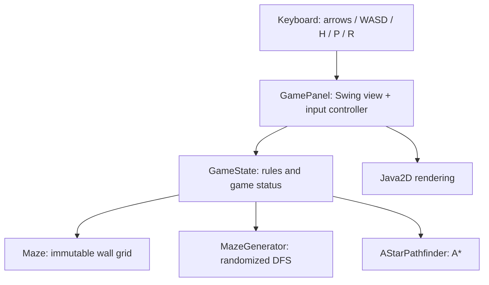
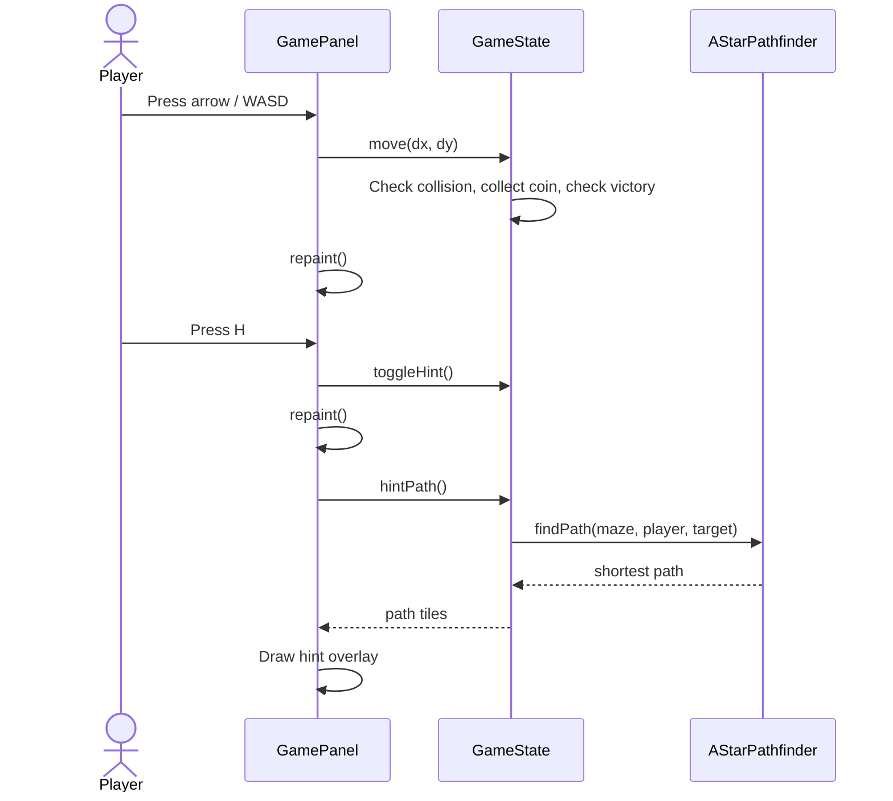

# Architecture

## Overview

A small layered architecture separates **game state**, **algorithms**, and **Swing UI**. There is no network service or database.

## Classes and ownership

| Component | Responsibility |
|---|---|
| `MazeQuestApp` | Starts JFrame on Swing's Event Dispatch Thread |
| `GamePanel` | Key bindings, colors, visual grid, HUD, pause/win overlay |
| `GameState` | Player, coins, victory condition, movement, timer, hint target |
| `Maze` | Defensive copy of walls, safe walkability queries |
| `Position` | Immutable coordinate value object (`record`) |
| `MazeGenerator` | Connected maze generation with iterative randomized DFS |
| `AStarPathfinder` | Shortest path to a target on four-connected grid |

## Input-to-render sequence

## Generation

Starting at (1,1), visit cells two steps apart and remove separating walls. When blocked, backtrack. The resulting perfect maze has exactly one simple path between every pair of carved cells. Outer boundary remains a wall. For the V1 fixed odd dimensions (25×19), all reachable floor tiles are part of a single connected component.

## A* pathfinding

- **Graph:** walkable tiles; edges to 4 orthogonal neighbors, each of cost 1.
- **Heuristic:** Manhattan distance `|x1-x2| + |y1-y2|` (admissible and consistent).
- **Frontier:** priority queue ordered by `g + h`; parent pointers reconstruct a route.
- **Hint selection:** compute a route to each remaining coin, choose the shortest found route; after all coins, target the exit.
- **Behavior:** the displayed hint is not a global traveling-salesperson optimum for collecting all coins; it chooses the closest next coin greedily.

## Design decisions

- Swing/Java2D: available in standard Java, no runtime dependencies, desktop-first.
- Java 17+: uses `record` for `Position` and A* internal node.
- `GameState` does not depend on Swing: headless logic tests are easy.
- `System.nanoTime()`: monotonic timing for elapsed play (rather than wall-clock time).
- UI timer repaints every 250 ms; it does **not** control game movement or simulation.

## Current limitations

UI and keyboard controller currently share `GamePanel`; consider splitting these if the project grows. No audio or accessible alternative control scheme exists yet. There is no persistence, network integration or large-scale automated UI testing.
