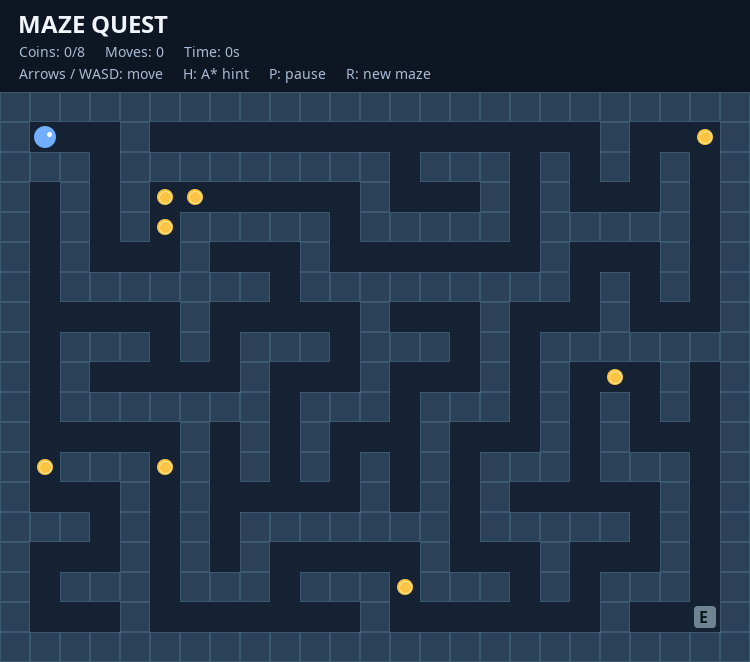

# Interface & UX specification (V1)

## Implemented screen



The app opens directly into gameplay. The screenshot is a rendering of the actual Java Swing panel, not an external mockup.

### Visual layout

```text
+------------------------------------------------------------------+
| MAZE QUEST                                                       |
| Coins: 0/8       Moves: 0          Time: 0s                       |
| Arrows / WASD: move   H: A* hint   P: pause   R: new maze        |
+------------------------------------------------------------------+
| ████████████████████████████████████████████████████████████     |
| █ [player] ... corridor ... coin  ... █                       |
| █   walls form a new maze each run ... █                       |
| █ ... coin ... [exit E] ...                                █     |
+------------------------------------------------------------------+
```

### Palette

| Element | Approximate color |
|---|---|
| App background | `#0E1624` |
| Corridor | `#142234` |
| Wall | `#2B4158` |
| Player | `#71AEFF` |
| Coin | `#FCC442` |
| Exit (locked for victory) | `#6E8492` |
| Exit (ready) | `#4ADE80` |
| Hint route | translucent cyan |

### States

- **Playing:** HUD and board visible.
- **Paused:** centered overlay with “PAUSED”, input blocked except P/R/H.
- **Won:** centered “YOU WIN!” overlay, movement blocked; R creates next run.

### Interaction guidelines

- Keyboard-centric, no mouse required once the window has focus.
- A valid move updates player, collected coins, move counter, and victory state.
- Walls do not consume moves.
- Help text remains visible above the board.

## Planned UX (not implemented)

A main menu, level selection, setting controls, sound, themes, touch/gamepad controls, and a dedicated A* teaching mode are future ideas. Do not advertise them as shipped features.
